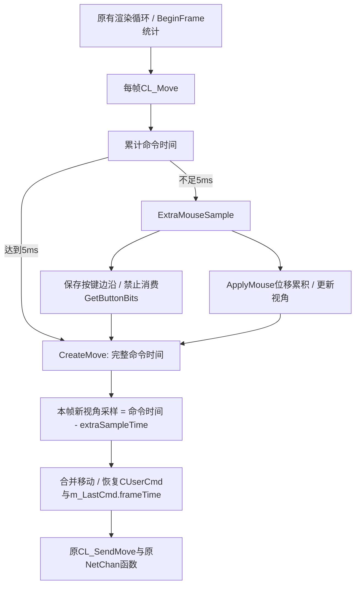

# Ion四个提交与最小移植

核对时间2026-09-28；git ls-remote HEAD仍为cdfccc734cb0b857f24e018aeefc190e9bc50afe。完整patch保存于upstream，便于按提交复核。

| 提交 | 关键变化 | 本插件采用范围 |
|---|---|---|
| [337d468](https://github.com/r2ion/IonLauncher/commit/337d468e2af92414e9658ddf934f430835e181da) | 新cl_main、命令调度与网络发包决策解耦；同时改变限帧相关代码 | 只采用CL_Move调度思路，不移植fps_max修改 |
| [1811488](https://github.com/r2ion/IonLauncher/commit/18114886fe7199e1e377dbcb23a10ec76794d583) | 扩充SDK、输入累积与client-time相关结构/调用 | 使用所需字段偏移与接口ABI，未引入SDK整棵类继承树 |
| [0786036](https://github.com/r2ion/IonLauncher/commit/0786036d9ceea428b8935b9b612bc0ab692bb957) | ExtraMouseSample、GetButtonBits、ApplyMouse、CreateMove、客户端时间精度 | 9个输入/时间hook及CL_Move中的额外采样调用 |
| [cdfccc7](https://github.com/r2ion/IonLauncher/commit/cdfccc734cb0b857f24e018aeefc190e9bc50afe) | 缺失ConVar时重新查找 | 改为读取原引擎注册指针，验证名称/父对象；无效时等待或回退，避免继续空指针解引用 |

## 必须保留的路径

实现仅有11个hook：CL_Move、8个CInput/C_Player输入函数、SetClientTime、用于诊断的BeginFrame。20个签名还覆盖调用的原生辅助函数。CUserCmd关键字段：forwardmove=0x34、sidemove=0x38、buttons=0x40、frameTime=0xAC；玩家LastCmd起始0x2900。字段和接口只适用于build_profile列出的零售模块。

按键状态保留与鼠标移动合并是必需的：跳过CL_Move直接return会漏输入；让下次CreateMove再次采样完整累计时间会双重积分视角；只减少命令数不恢复完整frameTime会改变模拟节奏。

SetClientTime仅对engine+0x15952B返回地址的增量累积调用使用double余数；其他调用、不同客户端对象、时间突变会清余数。计算上限为serverUptime。原SetClientTime继续执行。

## 网络与上游差异

上游已经替换整个CL_Move调度，调用原CanPacket、SetChoked、CL_SendMove、SendNetMsg和SendDatagram。本插件同样保留这些原函数及其协议序列化，不重实现netchan、ack或报文。客户端tick消息使用原引擎vtable和经过大小/偏移断言的0x38字节数据结构，避免MinGW与MSVC的C++对象ABI差异。

差异均有明确边界：

- 只允许明确的R2Vanilla profile，固定5ms；不提供Ion的1ms非Vanilla分支。
- 暂停、播放demo、缺少必要对象、cl_move_use_dt=0或无效时间值时清理累积并调用原CL_Move，不采用上游暂停分支。此处优先保留原暂停/demo语义，待实机确认恢复时序。
- 连接对象改变也会清理累计状态；时间余数按客户端对象隔离。
- 使用原引擎已注册ConVar的指针及父对象，不引入CVar子系统，也不修改ConVar值。
- 不引入Ion的UI、服务发现、P2P、脚本、mod系统、低延迟渲染功能或其他玩法补丁。
- BeginFrame只用于计数，不修改渲染策略。命令CSV从真实C_Player::CreateMove路径记录，不根据FPS推测。
- QPC用于暂停前后追踪/诊断；正常命令时间仍使用原GetFrameTime。该版本暂停回退使QPC不参与正常命令frameTime。

模块fingerprint与唯一入口签名、调用点校验在任何hook启用前完成；相同入口已有其他hook会导致拒绝。本次已有R2Vanilla ABI1加载器源码已现场核对，manifest resource101和initializePlugin与其匹配，仍未验证真实启动链。

## 190与240的边界

190帧/秒的单帧约5.263ms；240约4.167ms。5ms最低间隔下，前者约一帧一命令，后者理想情况下约两帧一命令（120Hz）。205也可能约102.5Hz，而不是被平滑限制到200Hz。恰好200的浮点/帧抖动会影响是否跳过，帧率数字不足以推出实际边界。

离线模拟得到这一行为；**尚无游戏CUserCmd时间戳，因此不能声称实际转折在约200FPS已验证**。验证方法见testing.md。
